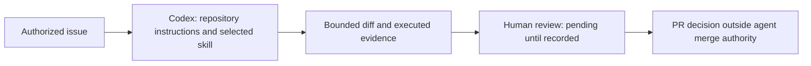

# ADR-007: repository-scoped AI workflows

Status: **proposed documentation of the approved catalog**, 13 November 2026.
Catalog implementation is approved by #16; this ADR has no separate human sign-off.

Context: merged runtime baseline `236d4dd18ef5648a2af9c6fa952ee706e30a256d`
has real check commands but no repository AI handoff or evaluation artifacts.
The PHP routes, MySQL and same-origin camera remain unchanged.

Problem: make AI assistance inspectable without confusing instructions with
permissions or unmeasured claims with productivity evidence.

Options: repository instruction-only skills keep versioned context near code,
with modest maintenance cost. Personal skill installation causes environment
drift and is outside scope. Executable automation adds review and maintenance
cost without demonstrated recurring need. A general application AI service is
outside the approved direction.

Recommendation: the three approved instruction-only skills, shared root rules,
linked templates, frozen fixtures and human-scored evaluations. Consequences:
owners must maintain references, rerun discovery on tool upgrades and supply human
review; prompts cannot enforce permissions. Revisit when repeated failures justify
a bounded helper or when the selected tool changes its format.

This is the proposed workflow, not a new application trust boundary. Enforcement
remains with environment permissions and human review. Migration: add rules and
catalog, validate discovery, evaluate frozen tasks, record a real bounded trial,
then obtain human scoring. Validation conditions and pending gates are linked in
[evaluations](evaluations/README.md). Rollback: revert the documentation/skill diff;
no schema, runtime data or personal skill installation changes are involved.
