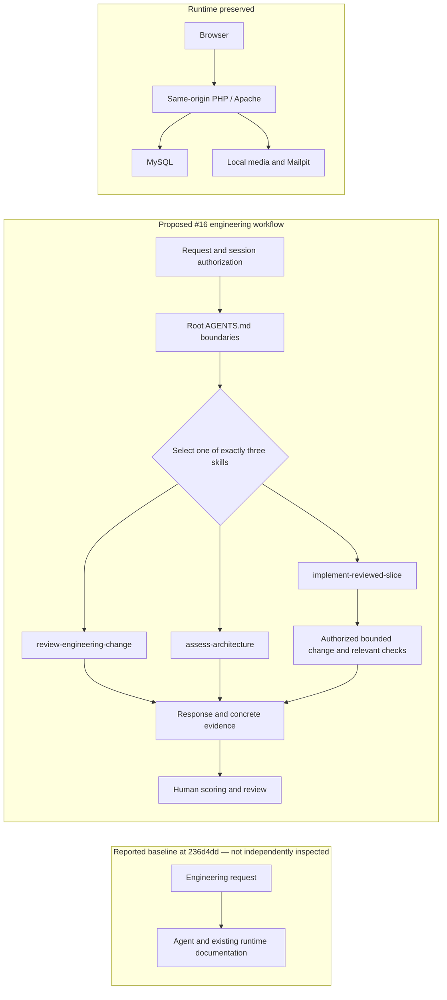

Proposed ADR: repository-scoped instruction skills for issue #16

Status: **proposed**. Date: 13 November 2026. Author: Codex, GPT-6 based agent; exact serving model unknown. Assessment baseline: `236d4dd18ef5648a2af9c6fa952ee706e30a256d`, reported by the task as containing no AGENTS.md, skills or ADRs. I did not independently inspect that ref.

The supplied requirements describe issue #16 as approved. The recommendation below remains a proposal requiring owner review. This assessment used local, read-only inspection; it made no edits or external calls.

Context and decision drivers

Camagru’s documented runtime is PHP/Apache with MySQL, local Mailpit, relative same-origin camera requests, photo capture/upload, three overlays, gallery, social and account functionality ([README.md](C:/Users/lenovo/Camagru/README.md:6)). The handoff explicitly preserves PHP/MySQL and same-origin sessions ([AGENTS.md](C:/Users/lenovo/Camagru/AGENTS.md:4)).

Concrete runtime boundaries include an explicitly configured public application URL instead of request-Host-derived email links ([application.php](C:/Users/lenovo/Camagru/config/application.php:3)), access logging without query strings, denied access to internal directories, and disabled PHP execution in uploads ([apache.conf](C:/Users/lenovo/Camagru/docker/apache.conf:3)). These observations do not establish comprehensive security.

The proposed change concerns engineering instructions. It should neither enter the application request path nor expand agent authority. Repository instructions expressly distinguish tool availability from permission and require human review before merging ([AGENTS.md](C:/Users/lenovo/Camagru/AGENTS.md:11)).

The requirements are:

- Provide exactly `review-engineering-change`, `implement-reviewed-slice` and `assess-architecture`.
- Share reviewable instructions with the repository.
- Retain real runtime checks and their coverage limits.
- Preserve session authorization and human scoring.
- Avoid unrelated runtime, frontend, deployment or account changes.

Options

| Option | Benefits | Costs and risks | Assessment |
|---|---|---|---|
| Repository-scoped instruction-only skills | Versioned with the project; changes review alongside requirements; collaborators can inspect the same paths; no executable lifecycle added | Model compliance and routing remain variable; documentation can drift; discovery depends on the supported environment | Smallest viable choice |
| Personal/global installation | Convenient across projects; individually customizable | Installation and version drift; project instructions may affect unrelated work; repository cannot establish which personal version ran | Unnecessary for #16; separate installation authorization would be needed |
| Executable scripts, hooks or agents | Can make some mechanical checks repeatable | Adds maintenance, execution and error-handling surfaces; side effects require explicit authorization; cannot mechanically establish architecture quality or browser parity | Defer until a specific repeated task justifies bounded automation |

Instruction-only skills have no established effect on application accessibility or request performance. They can direct relevant accessibility and browser checks, but cannot establish those outcomes through documentation alone. No latency, productivity or security improvement was measured.

Recommendation

Use exactly three repository-scoped instruction skills under `.agents/skills/`, with shared boundaries and actual commands in root `AGENTS.md`, concise routing documentation, and linked output templates. Do not introduce executable scripts, hooks, new tool grants or personal installation as part of #16.

This matches the current workflow’s stated design: repository discovery, no executable skill scripts or hooks, and no modification of personal/global settings ([workflow.md](C:/Users/lenovo/Camagru/docs/ai-engineering/workflow.md:12)). That file describes the implementation under assessment; it is not independent proof that discovery or behavior succeeds.

Retain these permission distinctions:

- Review and architecture selection authorize reading and a response.
- Implementation requires an approved issue and session authorization.
- Preparing a requested PR does not authorize merging, deployment, issue closure or unsolicited external comments.
- Human scoring remains necessary for output quality; parser success cannot substitute for it.



The diagram represents a required workflow, not an enforcement mechanism. Instructions alone cannot prevent unauthorized behavior.

Migration slices and rollback

1. Confirm #16’s acceptance criteria, dependencies and roadmap alignment; inspect existing work. Establish the shared boundary document and three skill entry points on a dedicated branch.
2. Add linked templates and routing guidance. Verify that each skill serves its distinct task and shared commands remain accurate.
3. Validate repository discovery and selection in the supported Codex environment. Record tool/version details, selected paths and parser errors.
4. Run frozen behavioral tasks with declared instruction differences and the same source baseline. Have a human score routing, evidence, scope control, authorization compliance and output usefulness.
5. Prepare the requested PR with exact checks, unavailable coverage and pending human decisions. Require human review.

These are bounded slices within #16. None requires a runtime migration, database change or personal installation. Rollback is a reviewed revert of #16’s documentation and skill files while preserving unrelated work.

Observable validation

For documentation, require exactly three discoverable repository skill names, valid front matter, resolving local links, consistent boundaries and a clean `git diff --check`. Independently check automatic routing and output quality: explicit invocation and discovery do not establish reliable implicit selection.

Preserve the existing runtime commands:

```sh
docker compose up --build -d --wait
docker compose exec web sh -c "find . -name '*.php' -print0 | xargs -0 -n1 php -l"
docker compose exec web php tests/smoke.php
docker compose up -d --force-recreate --wait
docker compose exec web php tests/smoke.php --verify-persistence
git diff --check
```

Runtime changes require relevant runtime checks. Smoke testing retains synthetic records/photos and therefore requires disposable isolated volumes. Browser camera capture, local-file selection, all overlays, gallery/social/account parity and persistence need their documented checks; a posted synthetic PNG does not prove the browser capture/upload flow ([README.md](C:/Users/lenovo/Camagru/README.md:93)).

Limitations and required decisions

Only authorized source reads were executed; no discovery, runtime checks, behavior trials or human scoring were performed by this assessment. The issue, dependencies and roadmap were not retrieved because external tools were prohibited; their approval and requirements were supplied by the task. The raw sources inspected do not independently prove session behavior or full application parity.

Owner review must accept the proposed storage and permission model. Human scorers must assess actual outputs before claims of workflow quality. Revisit executable automation only after repeated evidence identifies a mechanical task with explicit inputs, bounded side effects, authorized execution and a useful failure strategy.
